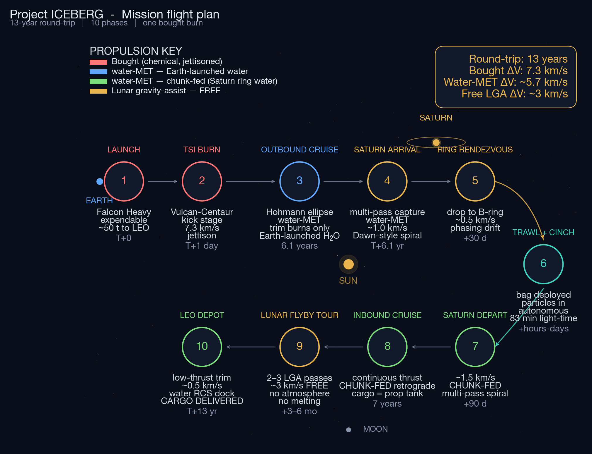
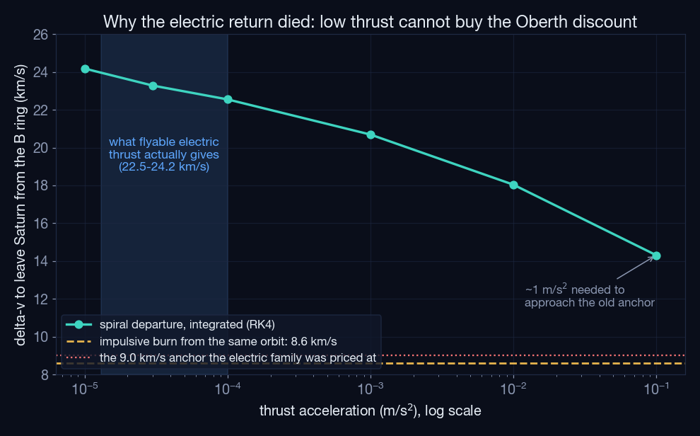
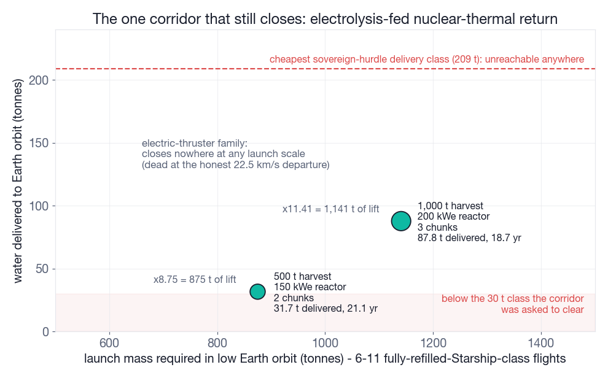
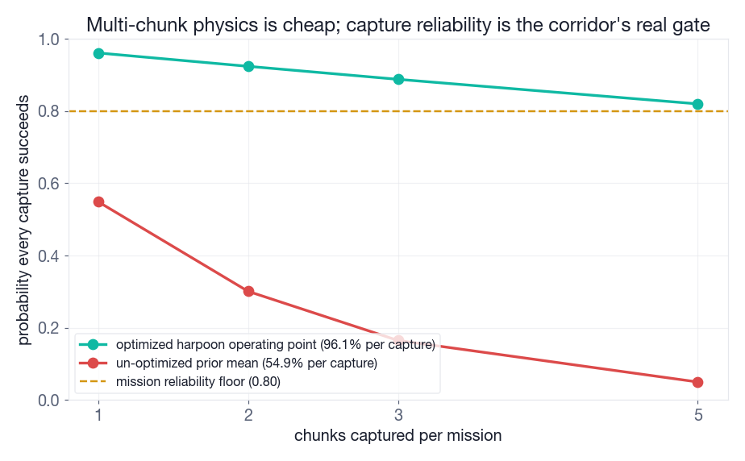
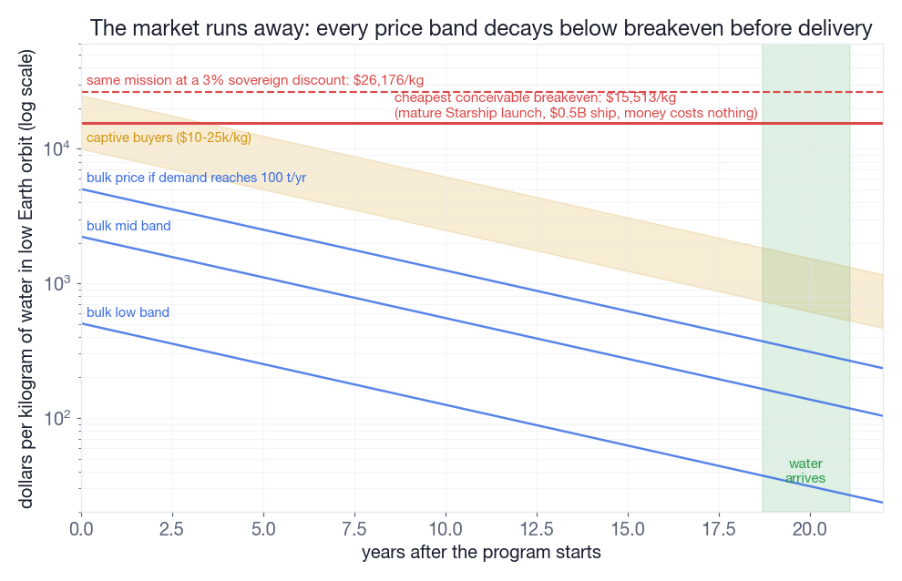

# Project ICEBERG

Project ICEBERG is a paper study of harvesting multi-tonne water-ice chunks from Saturn's B ring for propellant in Earth orbit. The study has no hardware and no booked flight. The harvested chunk is also the return-leg propellant tank: the tug feeds its own cargo to a water microwave-electrothermal thruster through a sublimation-capture trawl bag.

A 215-round adversarial analysis campaign found that no commercial round trip closes on technology in flight today. The only corridor that closes on paper needs ring-chunk capture, continuous propulsion on ring-sourced water, and a flight fission reactor at once. Each is an unproven technology. The financial model, left as an open dependency for fourteen months, is negative everywhere on that corridor ([full write-up](https://www.robotrocketscience.com/projects/iceberg/)).



## Campaign verdict (2026-07)

None of the 1,744 record-technology paths completes the round trip at any flyable power class, with delivery floors of 0.5-25 tonnes and mission ceilings up to 35 years. The closed-loop code derives vehicle mass from its contents and conserves mass through every burn and jettison. Each phase's power must match the onboard powerplant. Early rounds left dry mass free and found thousands of conditionally closing paths. Relaxed ground rules do not help ([R_l0_relaxation_envelope](water-prop/rounds/R_l0_relaxation_envelope/)). No single parameter closes it at any value, whether specific impulse, reactor power, dry-mass fraction, launcher capacity, or capture scale ([R_closure_boundary_inversion](water-prop/rounds/R_closure_boundary_inversion/)). Closure requires changing at least three parameters at once.

Electric-return paths fail under direct integration. They assumed a 9.0 km/s Saturn departure, but a low-thrust spiral gets no Oberth discount and costs 22.5-24.2 km/s at flyable electric thrust ([R_departure_anchor_resolution](water-prop/rounds/R_departure_anchor_resolution/)).



The surviving corridor electrolyzes some harvested water into hydrogen and oxygen for a nuclear-thermal-class engine at 750-900 s specific impulse ([R_saturn_water_v2_electrolysis_departure](water-prop/rounds/R_saturn_water_v2_electrolysis_departure/)). It needs:

- 500-1,000 tonnes of ice per mission from two or three chunk captures ([R_multi_chunk_per_mission](water-prop/rounds/R_multi_chunk_per_mission/))
- a 150-200 kilowatt-electric reactor
- about 875-1,140 tonnes of launch mass in low Earth orbit ([R_per_phase_propellant_fidelity](water-prop/rounds/R_per_phase_propellant_fidelity/))
- a 25-year mission waiver

Delivery is 32 to 88 tonnes of water. The corridor shows what closure would take and is not a design; every element is at low technology readiness.





The financial model ([R_corridor_financial_model](water-prop/rounds/R_corridor_financial_model/)) puts breakeven at $15,513 per delivered kilogram at the cheapest conceivable inputs ($100-per-kilogram mature Starship launch, $0.5 billion marginal vehicle, no discounting). That is 3.1 times the top defensible bulk price band. A 3 percent sovereign discount rate raises it to $26,176. Anchored demand is 40-60 tonnes per year. Prices fall about 13 percent a year with launch costs. By delivery in year 19 to 21, every price band is one to two orders of magnitude below breakeven.



Work still worth doing:

- demonstrator-track bench tests of porous-ice penetration and capture-cinch reliability, and a measurement of hundred-tonne-class chunk number density in the ring, which no instrument has made
- sovereign or science cases valued on non-commercial grounds
- a near-Earth-asteroid successor study, which closes its mass loop on solar power where Saturn cannot ([R_near_earth_asteroid_mission_tree](water-prop/rounds/R_near_earth_asteroid_mission_tree/))

## Engineering bets

The mid-campaign verdict reduced closure to these bets. None has been retired since.

- Active capture of multi-tonne ring chunks at scale. No one has done it, and the corridor needs two or three captures per mission. With more than one chunk, per-capture reliability of 95 percent or better is the binding requirement.
- Continuous propulsion on ring-sourced water. Lab thrusters reach 700-900 s in pulses on clean water. The corridor trades this for another unflown propulsion mode: an electrolysis plant and nuclear-thermal burn.
- A flight fission reactor on program schedule. The United States flew one in 1965 and has cancelled six programs since.

## Repository contents

| Path | Contents |
|---|---|
| [`ICEBERG-conops.md`](ICEBERG-conops.md) | Working concept of operations: math, costed mission breakdown, trawl-bag engineering, economics, risk. |
| [`ICEBERG-pitch.md`](ICEBERG-pitch.md) | Executive-summary draft with audit history and current-status addendum. |
| [`ICEBERG-demand.md`](ICEBERG-demand.md) | Per-buyer demand, alternative-cost stacks, willingness-to-pay curves, lunar-resource crossover model. |
| [`ICEBERG-bag-engineering.md`](ICEBERG-bag-engineering.md) | Particle cull sizing, permeability aging, stationkeeping delta-v during fill. |
| [`saturn-water-isru-sketch.md`](saturn-water-isru-sketch.md) | Original back-of-envelope sketch. |
| [`REQUIREMENTS.md`](REQUIREMENTS.md) / [`REQUIREMENTS-L1.md`](REQUIREMENTS-L1.md) | Level-0 and Level-1 requirements with a variance log. |
| [`RISKS.md`](RISKS.md) | Risk register. |
| [`TRADE-end-of-mission-conops.md`](TRADE-end-of-mission-conops.md) | End-of-mission disposal trade study. |
| [`design-axes/`](design-axes/) | 22 architecture-decision records, one per design axis, append-only. |
| [`water-prop/`](water-prop/) | 215 analysis rounds under `rounds/`, each with a pre-registered study and a runnable `run.py`; physics models in `src/waterprop/`; closed-loop mission-graph code in `sims/mission_graph/` (179 tests). |
| [`plots/`](plots/), `*.py` at root | Plots and their scripts. Corridor-era figures regenerate from [`water-prop/scripts/plot_corridor_figures.py`](water-prop/scripts/plot_corridor_figures.py). |

## Reproduce the analysis

The campaign code is Python managed with [uv](https://docs.astral.sh/uv/).

```bash
cd water-prop
uv sync
uv run pytest tests/          # physics-model sanity tests
PYTHONPATH=src:sims uv run pytest sims/mission_graph/tests/   # closed-loop framework tests
uv run python rounds/R_closure_boundary_inversion/boundary_sweep.py   # or any other round
```

The root-level scripts (`saturn_isru_boe.py`, `saturn_rendezvous_sim.py`, `generate_conops_plots.py`) regenerate `plots/` and need numpy, scipy, and matplotlib. A few rounds' multi-megabyte JSON sweep outputs are excluded; each regenerates from its round's `run.py`.

## Method

Each round pre-registers hypotheses and falsification criteria ([`water-prop/PROTOCOL.md`](water-prop/PROTOCOL.md)); results stay unedited and retractions are recorded. [R_per_phase_propellant_fidelity](water-prop/rounds/R_per_phase_propellant_fidelity/) retracts a headline claim by the orchestrating agent, and [R_closing_path_self_consistency](water-prop/rounds/R_closing_path_self_consistency/) reverses a closure result caused by a simulation bug. A new closure claim needs a hand-checkable mass ledger before citation.

AI research agents (Claude) did the work in parallel orchestrated sessions. Human direction set the questions, locked ground-truth findings, and dropped assumptions that failed audit. Round documents name sessions by Saturn-moon codenames (titan, rhea, phoebe, and others).

## Excluded material

Some round documents cite files in the active private repository: a session log, a planning registry, a business-planning thread (`startup/`) and orchestration protocols. Citations stay unedited to keep the paper trail honest. This repository is a curated snapshot with fresh history.

MIT licensed.
